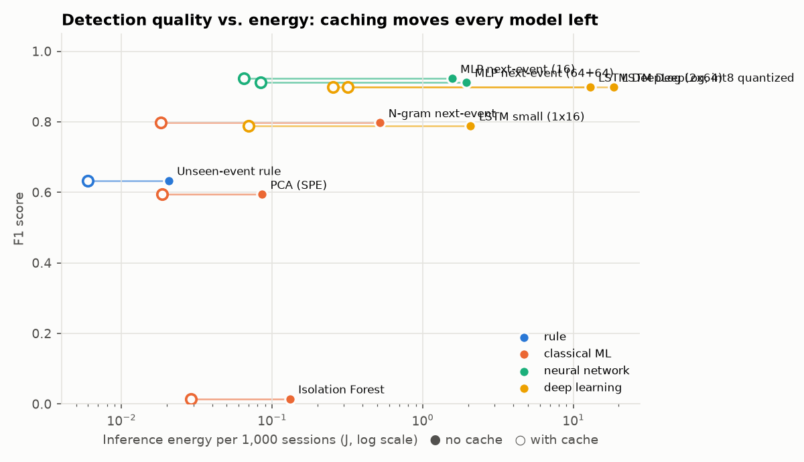

# Results: energy-aware anomaly detection on HDFS logs

Training data: 3884 normal sessions (971 more held out to set thresholds at a 1% false-positive target). Test: 553,366 normal and 16,838 anomalous sessions. Energy is **estimated** (estimate 3.75 W/core). Inference cost is measured on a fixed sample of 20,000 test sessions. Machine: x86_64, Python 3.14.4, single-threaded.

## 1. Log parsing (Drain, our implementation)

On LogHub's labelled HDFS sample (2,000 lines): grouping accuracy **0.9975**, 17 templates found (14 in the ground truth), 20,352 lines per CPU-second, 184.3 J per million lines (estimated).

## 2. Detection and cost

| detector | family | precision | recall | F1 | false-positive rate | training (CPU-s) | inference J / 1k sessions | with cache | model size |
|---|---|---|---|---|---|---|---|---|---|
| MLP next-event (16) | neural network | 0.872 (0.861–0.880) | 0.980 (0.976–0.987) | **0.923 (0.915–0.930)** | 0.44% | 39.7 | 1.56 | 0.0652 | 68 KB |
| MLP next-event (64+64) | neural network | 0.843 (0.824–0.873) | 0.993 (0.979–1.000) | **0.912 (0.903–0.923)** | 0.57% | 58.3 | 1.95 | 0.084 | 294 KB |
| LSTM DeepLog (2x64) | deep learning | 0.862 (0.845–0.880) | 0.940 (0.821–1.000) | **0.898 (0.833–0.936)** | 0.45% | 254.2 | 12.9 | 0.253 | 225 KB |
| LSTM DeepLog, int8 quantized | deep learning | 0.862 (0.845–0.879) | 0.940 (0.821–1.000) | **0.898 (0.833–0.936)** | 0.46% | 236.0 | 18.5 | 0.316 | 65 KB |
| N-gram next-event | classical ML | 0.663 | 1.000 | **0.797** | 1.55% | 1.4 | 0.52 | 0.0182 | 9 KB |
| LSTM small (1x16) | deep learning | 0.827 (0.767–0.884) | 0.765 (0.593–0.988) | **0.788 (0.692–0.933)** | 0.48% | 40.4 | 2.08 | 0.0699 | 15 KB |
| Unseen-event rule | rule | 0.971 | 0.470 | **0.633** | 0.04% | 0.0 | 0.0205 | 0.00598 | 0 KB |
| PCA (SPE) | classical ML | 0.591 | 0.597 | **0.594** | 1.26% | 0.1 | 0.0856 | 0.0186 | 2 KB |
| Isolation Forest | classical ML | 0.024 | 0.010 | **0.014** | 1.26% | 0.7 | 0.131 | 0.029 | 392 KB |

Neural models: mean over training seeds, range in brackets. Detection metrics are exact over all test sessions. *With cache*: each distinct session (and, for next-event models, each distinct event history) is scored once.

## 3. Findings

- **Best detection:** MLP next-event (16), F1 0.923, at 1.56 J per 1,000 sessions without caching and 0.0652 J with caching.
- **Baseline that every model must beat:** a one-line rule (flag sessions with an event never seen in training) reaches F1 0.633 with precision 0.971, at 0.0205 J per 1,000 sessions. Isolation Forest and PCA do not beat it.
- **Smaller is not worse:** the 16-unit MLP scored F1 0.923 (0.915–0.930 over seeds) against 0.912 (0.903–0.923) for the 64+64 MLP, with a 4.3x smaller model and lower variation between seeds.
- **Caching is a free energy saving:** 96.8% of test sessions repeat an earlier sequence. Scoring each distinct sequence once cut inference energy 3–58x, with identical detections.
- **How a model is run can matter as much as which model:** the cached 16-unit MLP (0.0652 J, F1 0.923) uses less energy than the uncached n-gram model (0.52 J, F1 0.797).

**Limits:** HDFS is a public Hadoop dataset, not telecom logs; energy is estimated from CPU time, so it ranks detectors by CPU cost rather than measuring watts. Next-event thresholds are discrete (top-g), so a model's false-positive rate on test can differ from the 1% target.
